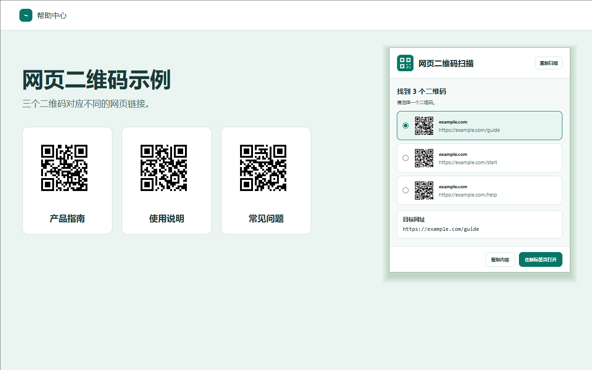

# Page QR Scanner for Chrome

[简体中文](README.md)

Page QR Scanner is a free, open-source Chrome extension that reads QR codes on the current web page. When it finds several codes, choose one by its thumbnail and preview the full destination before opening it. The extension runs locally and requires no account.

## Install

1. [Download the source ZIP](https://github.com/1922558420/chrome-page-qr-scanner/archive/refs/heads/main.zip) and unzip it, or clone the repository. No build or dependency installation is required.
2. Open `chrome://extensions/` in Chrome.
3. Turn on **Developer mode**, then click **Load unpacked**.
4. Select the folder containing `manifest.json`.
5. Open a page with a QR code and select **网页二维码扫描** from Chrome's Extensions menu.

## Use the scanner

The extension interface is in Simplified Chinese. Select **同意并扫描** (Agree and scan) the first time you use it. After that, opening the popup starts a scan.

- A single result opens in the preview. When several results appear, select a thumbnail to preview its content. Codes with identical content appear as one result.
- Click **在新标签页打开** (Open in new tab) to open an HTTP or HTTPS link. Click **复制内容** (Copy content) to copy any decoded result.
- The scanner reads the visible page and can also read loaded images and canvases that Chrome allows it to access. For lazy-loaded images, cross-origin images, or CSS backgrounds, scroll the QR code into view and click **重新扫描** (Scan again).

## Privacy

The extension uses `activeTab` for temporary access to the current tab and `scripting` to read page images. The bundled ZXing decoder processes the images on your device. The extension does not upload screenshots or decoded data, or keep a scan history. It saves only your first-use consent in the current Chrome profile.

## Development

Load the repository as an unpacked extension and click **Reload** on `chrome://extensions/` after changing files. `popup.js` handles the popup and link navigation, `page-images.js` reads accessible page images, and `scan-worker.js` decodes QR codes in a worker.

## License

The extension source is licensed under the [MIT License](LICENSE). Bundled third-party components retain their respective licenses. See the [third-party notice](vendor/NOTICE.txt).
