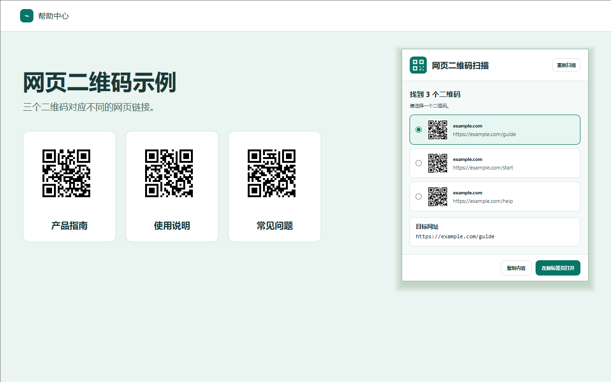

# 网页二维码扫描

[English README](README.en.md)

「网页二维码扫描」是一款免费、开源的 Chrome 扩展。在电脑上遇到二维码时，点击扩展图标即可查看内容。页面有多个二维码时，可以通过缩略图挑选，核对完整网址后再决定是否打开。

## 本地安装

1. [下载源码 ZIP](https://github.com/1922558420/chrome-page-qr-scanner/archive/refs/heads/main.zip)并解压。也可以克隆仓库。无需构建或安装依赖。
2. 打开 Chrome，在地址栏输入 `chrome://extensions/`。
3. 开启右上角的「开发者模式」，点击「加载已解压的扩展程序」。
4. 选择解压后包含 `manifest.json` 的文件夹。
5. 打开含有二维码的网页，从 Chrome 的扩展程序菜单点击「网页二维码扫描」。

## 使用

- 首次打开时，阅读本机数据处理说明并点击「同意并扫描」。之后点击扩展图标即可开始扫描。
- 找到一个二维码时，弹窗直接显示其内容。找到多个时，选择对应的缩略图查看完整内容。相同内容合并为一项。
- 点击「在新标签页打开」才会跳转。这个按钮支持 HTTP 和 HTTPS 网址，其他内容可以复制。
- 扫描覆盖当前可见画面，以及网页中已加载、浏览器允许读取的图片和 Canvas。对于懒加载的内容、受跨域限制的图片和 CSS 背景，请先把二维码滚动到可见范围，再重新扫描。

## 隐私

扩展使用 `activeTab` 临时访问当前标签页，并使用 `scripting` 读取页面图像。二维码由随包提供的 ZXing 解码器在本机识别。扩展不上传截图或识别结果，也不保存扫描历史。仅在当前 Chrome 用户配置中保存首次同意的状态。

## 开发

在 Chrome 中按上述步骤加载源码目录。修改文件后，在 `chrome://extensions/` 里点击该扩展的「重新加载」即可测试。`popup.js` 控制弹窗与跳转，`page-images.js` 读取网页中可访问的图像，`scan-worker.js` 在独立 Worker 中解码。

## 许可证

扩展源码采用 [MIT 许可证](LICENSE)。随包分发的第三方解码器遵循各自的许可证，见 [第三方声明](vendor/NOTICE.txt)。
